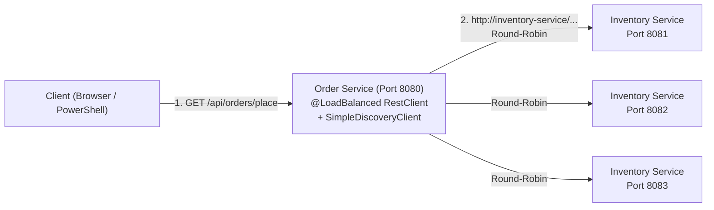

# Nội dung copy lên Slide 6 & Slide 7 (Member 3 — 3 phút)

---

## Slide 6: Demo System Architecture

### 1. Sơ đồ kiến trúc (có thể dùng Mermaid / vẽ box trên PowerPoint)



### 2. Bullet points gợi ý đặt trên Slide 6

- **Order Service (Port 8080)**
  - Đóng vai trò **Service Consumer / Load Balancer Client**, tiếp nhận request đặt hàng và tích hợp sẵn Spring Cloud LoadBalancer.
- **Inventory Service (Ports 8081, 8082, 8083)**
  - Cùng một microservice kiểm tra tồn kho, chạy thành **3 instance độc lập** trên các port `8081`, `8082`, `8083`.
- **Client-to-Service Request Flow**
  1. Client gửi request tới `Order Service (:8080)`.
  2. `Order Service` gọi `http://inventory-service/api/inventory/check` thông qua `@LoadBalanced RestClient`.
  3. `LoadBalancerInterceptor` chọn 1 trong 3 instance theo **Round-Robin** (`8081 → 8082 → 8083`) và chuyển tiếp request.
- **Static Service Instance Configuration**
  - Khai báo danh sách instance tĩnh trong `application.yml` (`SimpleDiscoveryClient`) thay vì dùng Eureka Server riêng, tập trung minh họa cơ chế Client-Side Load Balancing.

---

## Slide 7: Spring Cloud LoadBalancer Implementation

### 1. Project Structure & Dependencies
```text
demo/
├── inventory-service/          # spring-boot-starter-web (Ports 8081, 8082, 8083)
└── order-service/              # spring-boot-starter-web + spring-cloud-starter-loadbalancer (Port 8080)
```
```xml
<!-- order-service/pom.xml -->
<dependency>
    <groupId>org.springframework.cloud</groupId>
    <artifactId>spring-cloud-starter-loadbalancer</artifactId>
</dependency>
```

### 2. Configuring Service Instances (`order-service/src/main/resources/application.yml`)
```yaml
server:
  port: 8080

spring:
  application:
    name: order-service
  cloud:
    discovery:
      client:
        simple:
          instances:
            inventory-service:
              - uri: http://localhost:8081
              - uri: http://localhost:8082
              - uri: http://localhost:8083
```

### 3. `@LoadBalanced RestClient` (`RestClientConfig.java`)
```java
@Configuration
public class RestClientConfig {

    @Bean
    @LoadBalanced
    public RestClient.Builder loadBalancedRestClientBuilder() {
        return RestClient.builder();
    }
}
```

### 4. Calling Services by Logical Name (`OrderService.java`)
```java
InventoryResponse inventory = restClient.get()
        .uri("http://inventory-service/api/inventory/check?product={p}&quantity={q}",
             product, quantity)
        .retrieve()
        .body(InventoryResponse.class);
```
> **Key takeaway:** Code chỉ gọi logical name `inventory-service`, hoàn toàn không hardcode `localhost:8081`.

